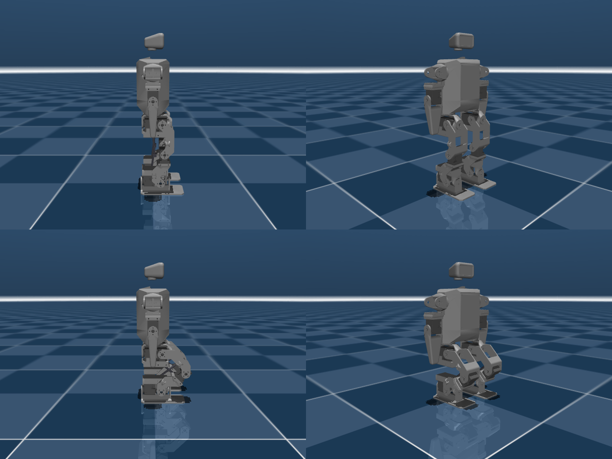

# reduced-dof-humanoid

Reduced-DOF humanoid for ROBO-ONE Light, derived from Rhoban's
[Microban](https://github.com/Rhoban/microban) (unofficial, not affiliated with
Rhoban or the author of Microban).

**Status: experimental.** The repository holds three MuJoCo models of Microban
generated from the same script: a 16-servo step (passive parallel-link ankle
pitch, fixed head), the **14-servo layout chosen for the robot** (additionally
no shoulder roll: legs 5 × 2 with hip yaw, arms 2 × 2) and a 12-servo study
(no hip yaw either), plus the scripts that generate and verify them. The
12-servo variant can only turn by scuffing its soles, which depends on the
floor; keeping the two hip-yaw servos was judged worth 46 g.

<p align="center">
  
</p>

## Why

Pollen Robotics' Microduck walks with 15 servos and no arms or ankle roll,
driven by a learned policy. It suggests that the usual 19–20 servo layout of
small humanoids is more than a walking robot strictly needs. ROBO-ONE Light,
however, requires two actuated arms, a head, and 10 mm foot clearance when
walking in all four directions, so the question is where the axes can be cut
while staying inside those rules and while keeping keyframe-style control
practical. The study behind this repository is in
[docs/design_ja.md](docs/design_ja.md) (Japanese).

| Joint | Decision | Reason |
| --- | --- | --- |
| Ankle pitch | passive (done here) | Two parallelograms per leg keep the foot parallel to the pelvis, as on the `ashigaru` robot. |
| Neck | remove (done here) | Rules only require a separate head, not an actuated one. A fixed head keeps the humanoid silhouette at zero servo cost. |
| Hip yaw | **keep** (removed only in the 12-servo study) | Without it the feet are always parallel and turning needs the soles to slip, which depends on the floor. |
| Shoulder roll | remove (done here) | Rules require one actuated axis per arm; shoulder pitch + elbow is enough for punching and getting up. |
| Hip roll, hip pitch, knee, ankle roll | keep | Needed for lateral stepping, 10 mm foot lift and flat-footed weight transfer with position-controlled servos. |

Chosen layout: legs 5 × 2, arms 2 × 2, fixed head → 14 servos, 0.719 kg in the
model (Microban: 19 servos, 0.819 kg; the 12-servo study: 0.673 kg).

## What is in the repository

```
model/microban_pl14/
  microban_pl14.xml      14-servo model (chosen layout), upstream joint names, position actuators
  microban_pl14_lme.xml  same with LegacyMotionEditor joint names
  scene.xml              floor + "standing" keyframe (meshes from ../microban_pl/assets)
model/microban_pl12/
  microban_pl12.xml      12-servo model (target layout), upstream joint names, position actuators
  microban_pl12_lme.xml  same with LegacyMotionEditor joint names
  scene.xml              floor + "standing" keyframe (meshes from ../microban_pl/assets)
model/microban_pl/
  microban_pl.xml        parallel-link Microban with fixed head, upstream joint names, position actuators
  microban_pl_lme.xml    same model with LegacyMotionEditor joint names (r_hipjoint_yp, ...)
  scene.xml              floor + "standing" keyframe for the MuJoCo viewer
  assets/                Microban meshes (unmodified, CC BY-NC-SA 4.0)
tools/
  make_microban_pl.py    generates the models above from Microban's robot.xml
  verify_parallel_leg.py loop closure, foot-parallel sweep and standing tests
  render_preview.py      renders docs/images/preview.png
docs/
  design_ja.md           DOF reduction study (ROBO-ONE Light rules, Microduck, per-joint decisions)
```

### Fixed head

The head body and mesh are kept, but the neck yaw joint and its servo are
removed, so the head bolts directly to the trunk. Pass `--neck-motor` to the
generator to keep the servo.

### The parallel-link leg

Per leg, a passive knee block is inserted between the femur and the tibia and
two passive rear links close two parallelogram loops (`<connect>` constraints).
The knee block, and therefore the foot, stay parallel to the pelvis in pitch.
Consequences:

- The ankle-pitch joint is passive; its servo and horn can be removed from the
  physical robot.
- The knee servo now acts between the knee block and the tibia, so the knee
  command is the shank angle **relative to the pelvis**, not to the thigh.
  Existing Microban motions must be re-authored.
- The rear pivots sit 20 mm behind the front pivots with a 10 mm tilt (down on
  the thigh, up on the shank), which moves the linkage singularities to 116.6°
  of flexion and 63.4° of extension. The joint ranges are derived from that with
  an 8° margin: hip −109°…+55°, knee −55°…+109° (pelvis-relative).
- The rear links are drawn as thin capsules and do not collide; interference
  with the real parts is not modelled yet.

### Parts that change on the printed robot

The generator also edits the model to reflect the parts the physical redesign
has to produce (`--keep-ankle-servo` and `--neck-motor` restore the originals):

| Part | Change | Effect in the model |
| --- | --- | --- |
| Ankle block | The ankle-pitch XL330 and its idler horn are removed. The U-bracket that wrapped the servo becomes a short clevis around the passive hinge (±6 mm about the axis in the collision model). | 47 g → 25 g per ankle. The knee can fold to 132° before the ankle meets the hip bracket, instead of 117°. |
| Neck | The neck XL330 in the top of the trunk is removed; the head bolts on. | −23 g in the trunk. |
| Rear links | Two per leg, 62 mm (thigh) and 61 mm (shank) between pivots, 2 mm radius capsules in the model. | Close the parallelogram loops. |
| Knee block | New part between femur and tibia: carries the knee servo horn, the two rear-link pivots, and stays parallel to the pelvis. | 3 g placeholder mass. |

| Hip yaw (12-servo study only) | The two XL330s in the bottom of the trunk are removed; each hip bracket bolts straight to the trunk. | −46 g. No turning on the spot. |
| Shoulder roll (14- and 12-servo models) | The XL330 at the top of each humerus is removed; the humerus bolts to the shoulder bracket with the arm at the side. | −46 g. |

Total mass: 0.833 kg (upstream model) → 0.765 kg (16-servo) → 0.719 kg (14-servo) → 0.673 kg (12-servo).

### Verification

`tools/verify_parallel_leg.py` checks the model in MuJoCo:

| Test | Result |
| --- | --- |
| Loop closure residual at the initial pose | 0.000 mm |
| Foot tilt relative to the trunk over 8 hip/knee combinations (gravity off) | ≤ 0.5° |
| Standing on a floor for 3 s, straight legs | trunk tilt 0.08° |
| Standing with hip −30° / knee +30° | trunk tilt 0.12°, feet flat |
| Standing with hip −60° / knee +60° | trunk tilt 0.33°, feet flat |
| Deepest symmetric squat before self-collision | 132° relative knee flexion (117° with the original ankle block) |

With LegacyMotionEditor's motion tools (keyframe walk re-solved through the
4-joint leg IK, scuff turns, get-ups found by physics beam search) the 12-servo
model passes, under servo-offset and tilt disturbances: walk forward/back and
sidestep 8/8, scuff turns 8/8, jabs 8/8, get-up from prone 15/16 and from supine
(roll over + the same rise) 16/16. Details in `docs/design_ja.md`.

With the original Microban model, commanding the same two hip/knee values
without adjusting the ankle tips the robot over; here the linkage keeps the
soles flat automatically.

## Usage

Requirements: Python 3.10+, `mujoco` (≥ 3.1), `numpy`; `Pillow` for rendering.

```bash
# view
python -m mujoco.viewer --mjcf model/microban_pl14/scene.xml      # 14-servo (chosen)
python -m mujoco.viewer --mjcf model/microban_pl12/scene.xml      # 12-servo study
python -m mujoco.viewer --mjcf model/microban_pl/scene.xml        # 16-servo
# regenerate from a Microban checkout
python tools/make_microban_pl.py path/to/microban/src/model/mjcf/robot.xml \
    model/microban_pl/microban_pl.xml --scene model/microban_pl/scene.xml
python tools/make_microban_pl.py path/to/microban/src/model/mjcf/robot.xml \
    model/microban_pl/microban_pl_lme.xml --naming lme
python tools/make_microban_pl.py path/to/microban/src/model/mjcf/robot.xml \
    model/microban_pl14/microban_pl14.xml --dof 14 --meshdir ../microban_pl/assets --scene model/microban_pl14/scene.xml
# verify
python tools/verify_parallel_leg.py model/microban_pl/microban_pl.xml
# preview image
MUJOCO_GL=egl python tools/render_preview.py model/microban_pl/scene.xml docs/images/preview.png
```

`make_microban_pl.py --back <m> --tilt <m>` changes the rear-pivot geometry (the
joint ranges follow); `--clevis <m>` sets the slimmed ankle bracket's half-height;
`--keep-ankle-servo`, `--neck-motor` and `--keep-motor` restore the upstream servo
geometry, the neck servo and Microban's torque actuators respectively.

For [LegacyMotionEditor](https://github.com/hijimasa/LegacyMotionEditor) point
`model_path` at `microban_pl_lme.xml`; the editor detects the four closed loops
and hides the eight passive joints from the sliders.

## Roadmap

1. CAD for the rear links, the knee block and the ankle clevis described above,
   so the ankle-pitch servo can actually be removed from a printed Microban.
2. Verify walking, scuff-turning and getting up on the 12-servo model in
   simulation with LegacyMotionEditor's motion tools (in progress), then re-check
   walking, side-stepping and getting up in simulation.
3. Foot-sole and leg-length check against the ROBO-ONE Light tables
   (sole ≤ 55 % of leg length, width ≤ 35 %).

## License

- Code, documentation and the generated MJCF files: **Apache-2.0** (the upstream
  `robot.xml` is itself Apache-2.0; its notice is retained).
- Meshes in `model/microban_pl/assets/`: **CC BY-NC-SA 4.0**, copyright Marc
  Duclusaud, unmodified copies from Microban. This makes the model as a whole
  **non-commercial**; see [NOTICE.md](NOTICE.md).

If you use Microban-derived content, please also cite Microban:

```bibtex
@software{mduclusaud-microban,
    author = {Duclusaud, Marc},
    doi = {10.5281/zenodo.20784789},
    month = jun,
    title = {{Microban: A Compact, Fully 3D-Printable Open-Source Humanoid Robot}},
    url = {https://github.com/Rhoban/microban},
    version = {1.0.0},
    year = {2026}
}
```

---

## 日本語の概要

Rhoban の Microban を元に、ROBO-ONE Light に出られる範囲で軸数をできるだけ減らした
ヒューマノイドを検討する実験用リポジトリです（非公式。Rhoban および原作者とは無関係）。

現在の内容は、ashigaru 方式のパラレルリンク脚で足首ピッチを受動化した Microban の
MuJoCo モデルと、その生成・検証スクリプトです。頭はモータ無しで胴体に固定します（19 軸 → 16 軸）。膝サーボの指令角は
大腿基準ではなく骨盤基準になります。股ピッチは −96°〜+68°、膝は −68°〜+96° に制限しています。

今後は股ヨー・肩ロールを外して 12 軸にすることと、足首サーボを実際に外せるように
3D モデル（後方リンクと膝ブロック）を設計することを予定しています。
軸ごとの削減判断と ROBO-ONE Light 規則との対応は [docs/design_ja.md](docs/design_ja.md) にまとめています。

メッシュは Microban の CAD 由来で CC BY-NC-SA 4.0 のため、モデル全体として非営利利用に限られます。
