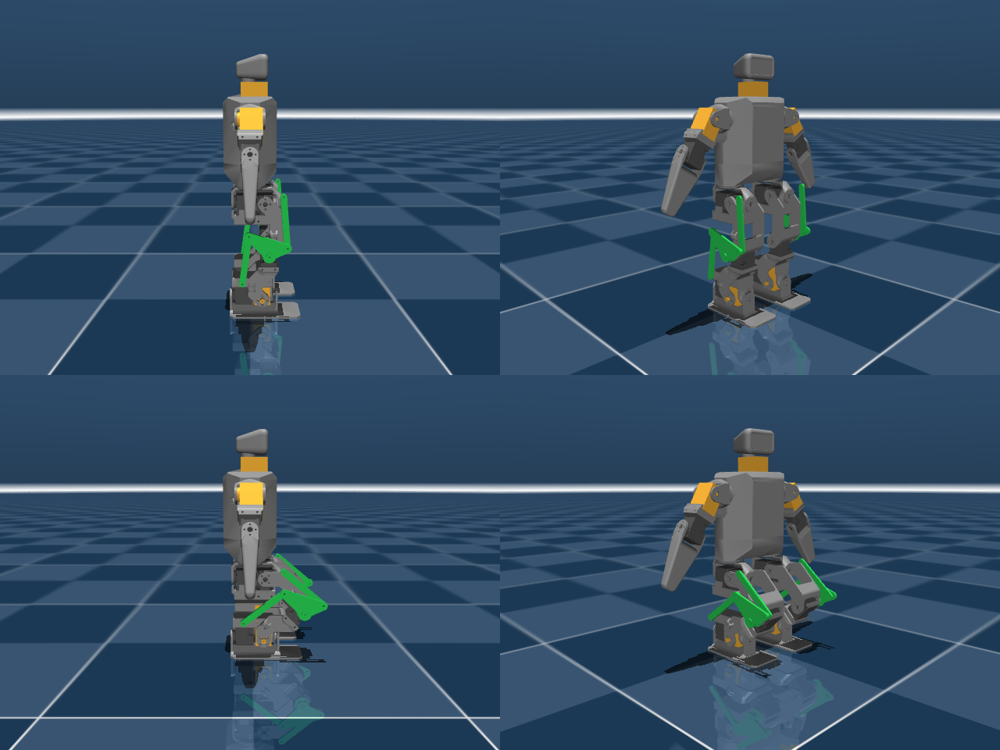
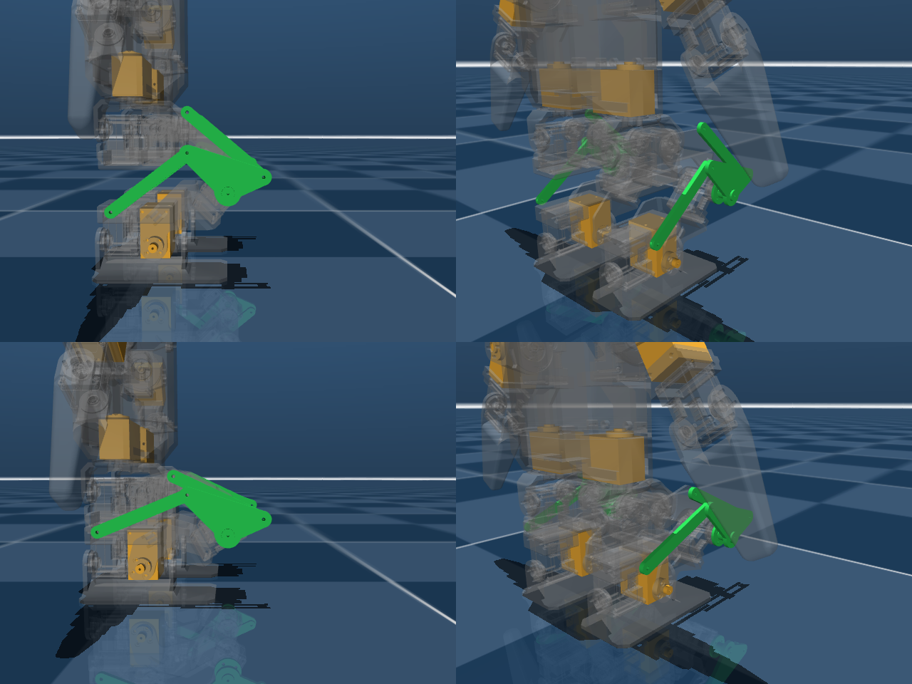

# reduced-dof-humanoid

[日本語版 README はこちら](README_ja.md)

Reduced-DOF humanoid for ROBO-ONE Light, derived from Rhoban's
[Microban](https://github.com/Rhoban/microban) (unofficial, not affiliated with
Rhoban or the author of Microban).

**Status: experimental.** One generator script produces three MuJoCo models of
Microban. Every removed servo is replaced by a printed block of the same
envelope, so the original brackets bolt on unchanged and servos can be put
back later.

| Model | Layout | Mass in the model |
| --- | --- | --- |
| 16-servo (intermediate step) | passive parallel-link ankle pitch, fixed head | 0.795 kg |
| **12-servo (standard build)** | additionally no shoulder roll and no hip yaw: legs 4 × 2, arms 2 × 2, printed XL330-shaped spacers where the hip-yaw servos were | 0.735 kg |
| **14-servo (upgrade)** | the 12-servo build with the two hip-yaw spacers swapped for real servos, so it turns on the spot instead of scuffing its soles | 0.765 kg |

Microban itself has 19 servos and weighs 0.819 kg in its model.

<p align="center">
  
</p>

## Why

Pollen Robotics' Microduck walks with 15 servos and no arms or ankle roll,
driven by a learned policy. It suggests that the usual 19–20 servo layout of
small humanoids is more than a walking robot strictly needs. ROBO-ONE Light,
however, requires two actuated arms, a head, and 10 mm foot clearance when
walking in all four directions, so the question is where the axes can be cut
while staying inside those rules and while keeping keyframe-style control
practical. The study behind this repository is in
[docs/design_ja.md](docs/design_ja.md) (Japanese).

| Joint | Decision | Reason |
| --- | --- | --- |
| Ankle pitch | passive (done here) | Two parallelograms per leg keep the foot parallel to the pelvis, as on the `ashigaru` robot. |
| Neck | remove (done here) | Rules only require a separate head, not an actuated one. A fixed head keeps the humanoid silhouette at zero servo cost. |
| Hip yaw | optional: spacer in the 12-servo build, servo in the 14-servo upgrade | Without it the feet are always parallel and turning needs the soles to slip, which depends on the floor (Robovie-nano manages the same way). |
| Shoulder roll | remove (done here) | Rules require one actuated axis per arm; shoulder pitch + elbow is enough for punching and getting up. |
| Hip roll, hip pitch, knee, ankle roll | keep | Needed for lateral stepping, 10 mm foot lift and flat-footed weight transfer with position-controlled servos. |

Standard build: legs 4 × 2, arms 2 × 2, fixed head → 12 servos, 0.735 kg in the
model including the printed spacers. Upgrade: + 2 hip-yaw servos → 14 servos,
0.765 kg. Microban: 19 servos, 0.819 kg.

## What is in the repository

```
model/microban_pl12/     12-servo model (standard): upstream joint names, LME joint names, viewer scene
model/microban_pl14/     14-servo model (upgrade)
model/microban_pl/       16-servo model, plus Microban's meshes (unmodified, CC BY-NC-SA 4.0) in assets/
model/parts/             printable DRAFTS of the added parts (STL, from tools/make_parts.py)
tools/
  make_microban_pl.py    generates the models above from Microban's robot.xml
  make_parts.py          CadQuery script: link bars, knee yoke, axle cap, standoffs, servo-shaped spacers
  verify_parallel_leg.py loop closure, foot-parallel sweep and standing tests
  check_clearance.py     sweeps hip/knee over their ranges and reports any part-vs-robot interference
  render_preview.py      renders the preview images
  render_parts_check.py  renders the added parts on a transparent robot (docs/images/parts_check.png)
  step_holes.py          reads hole patterns out of Microban's STEP parts
docs/
  design_ja.md           DOF reduction study: ROBO-ONE Light rules, Microduck, per-joint decisions, results, cost (Japanese)
  parts_ja.md            design memo for the added parts: pivot layout, packaging constraints, part list, open fit checks (Japanese)
```

Each model directory holds `<name>.xml` (Microban's joint names), `<name>_lme.xml`
(LegacyMotionEditor's names) and `scene.xml` (floor and a standing keyframe).

### Fixed head

The head body and mesh are kept, but the neck yaw joint and its servo are
removed, so the head bolts directly to the trunk. Pass `--neck-motor` to the
generator to keep the servo.

### The parallel-link leg

Per leg, a passive knee block is inserted between the femur and the tibia and
two passive link bars close two parallelogram loops (`<connect>` constraints).
The knee block, and therefore the foot, stay parallel to the pelvis in pitch.
Consequences:

- The ankle-pitch joint is passive; its servo and horn can be removed from the
  physical robot.
- The knee servo now acts between the knee block and the tibia, so the knee
  command is the shank angle **relative to the pelvis**, not to the thigh.
  Existing Microban motions must be re-authored.
- Thigh linkage: one bar **in front of** the thigh, pivots 22 mm ahead of and
  10 mm above the hip and knee axes (singular at 114.4° flexion / 65.6°
  extension). Shank linkage: one bar behind the shank, pivots 25 mm behind and
  25 mm above the knee and ankle axes, which lifts the ankle pivot clear of the
  ankle-roll servo and the foot (singular at 135° / 45°). Joint ranges follow
  with an 8° margin, and hip flexion is capped at 85° where the thigh bar would
  reach the knee axle: hip −85°…+58°, knee −37°…+127° (pelvis-relative).
- The added parts are drawn in green (mechanism) and amber (printed servo-shaped
  spacers). The green parts also collide (convex hulls), so interference between
  the mechanism and the rest of the robot shows up in simulation;
  `tools/check_clearance.py` sweeps the ranges and reports none inside them.

### Parts that change on the printed robot

The generator edits the model to match the parts the physical conversion needs
(`--keep-ankle-servo`, `--neck-motor`, `--elbow-flexion-only` and `--arm-abduct` are the knobs):

| Part | Change | Effect in the model |
| --- | --- | --- |
| Ankle block | The ankle-pitch XL330 and its idler horn come out; a printed block of the same envelope with Ø5.9 stub axles into the tibia's existing plate holes goes in (passive hinge). | 47 g → 33 g per ankle. The knee folds to 132° before the ankle meets the hip bracket, instead of 117°. |
| Neck | The XL330 in the top of the trunk comes out; a spacer goes in and the head bolts on. | −15 g. |
| Shoulder roll | The XL330 at the top of each humerus comes out; a printed block goes in whose fixed horn is indexed 30° about the roll axis, so the arm hangs abducted 30°. A hanging arm sits right over the knee's link stack; abducted, the forearm can be bent forward (60° in the gaits) like a walking human without touching it. `--arm-abduct` sets the angle. | −30 g. |
| Hip yaw (12-servo) | The two XL330s in the bottom of the trunk come out; spacers go in. The 14-servo upgrade puts the servos back. | −30 g. No turning on the spot. |
| Link bars | Per leg one thigh bar in front (62.2 mm between pins) and one shank bar behind (61.7 mm), 3 × 8 mm, M2 pins, both outboard of the leg in separate planes. | Close the parallelogram loops. |
| Knee yoke | A triangular plate outboard of the knee carrying both bar pivots, riding on a printed axle cap bolted to the knee servo horn; a small ear on the hip bracket carries the thigh bar's upper pivot. | 6 g. |

Total mass with the printed spacers (8 g each): 0.833 kg (upstream model) → 0.795 kg (16-servo) → 0.765 kg (14-servo) → 0.735 kg (12-servo).

### Cost

From Microban's own bill of materials (servos $23.90 each, everything else
about $113: Raspberry Pi Zero 2W, Robot HAT, batteries, BMS, charger, switch,
SD card, screws, shims, filament). The conversion adds about $5 of M2 screws,
washers and filament for the new parts.

| Build | Servos | Servo cost | Total | vs Microban ($567) |
| --- | --- | --- | --- | --- |
| Microban | 19 | $454 | $567 | — |
| 12-servo standard | 12 | $287 | ≈ $405 | −$162 (−29 %) |
| 14-servo upgrade | 14 | $335 | ≈ $453 | −$114 (−20 %) |

The U2D2 configuration tools ($56) are the same for all three and are not
included. Prices are the BOM's at the time of writing; ROBOTIS' Japanese
distributors price the XL330 somewhat higher.

### The printed parts (drafts)

`tools/make_parts.py` (needs `cadquery`) writes STL drafts of everything the
conversion adds, laid out in the Onshape frame of Microban's leg parts so they
can be dropped into the original assembly for a fit check. With `--parts` the
model generator draws these STLs in place of its box placeholders, so the
mechanism shows up in any viewer that renders meshes (LegacyMotionEditor's
preview included); their lateral positions are measured from the leg's centre
plane, not from the body origins, which sit on the inboard clevis plate. The placement was
checked against the model with collision on (below, originals transparent):
link bars 3 × 8 mm with M2 pins stacked outboard of the leg in three planes
(thigh bar 21–24 mm from the leg's centre plane, shank bar 24.5–27.5 mm, knee
yoke plate 28–31 mm), the yoke on an axle cap bolted to the knee servo horn, an
ear on the hip bracket for the thigh bar, an 11 mm standoff on the ankle
bracket for the shank bar, and dummy XL330 blocks for the shoulder-roll, neck
and (12-servo) hip-yaw positions. The ankle's passive hinge reuses the tibia's
existing Ø6 plate holes; the hip and ankle brackets each get M2 holes.

An earlier draft with the thigh bars behind the thigh did interfere: the inner
bars of the two legs came within 8 mm of each other, the thigh and shank bars
crossed in the same plane beyond 60° of hip flexion, and the hanging forearm
hit the knee yoke in the walking crouch. The present layout was reached by
sweeping hip and knee over their ranges with MuJoCo's collision detection
(`tools/check_clearance.py`) and by replaying the gaits; the only contact left
is the forearm brushing the shank bar by 0.5 mm when the robot squats with the
arms hanging exactly vertical, which no motion does. Why the pivots sit where
they do, and what is still unverified, is in [docs/parts_ja.md](docs/parts_ja.md).

<p align="center">
  
</p>

### Verification

`tools/verify_parallel_leg.py` checks the model in MuJoCo:

| Test | Result |
| --- | --- |
| Loop closure residual at the initial pose | 0.000 mm |
| Foot tilt relative to the trunk over 8 hip/knee combinations (gravity off) | ≤ 0.5° |
| Standing on a floor for 3 s, straight legs | trunk tilt 0.08° |
| Standing with hip −30° / knee +30° | trunk tilt 0.12°, feet flat |
| Standing with hip −60° / knee +60° | trunk tilt 0.33°, feet flat |
| Deepest symmetric squat before self-collision | 132° relative knee flexion (117° with the original ankle block) |

With LegacyMotionEditor's motion tools (keyframe walk re-solved through the
leg IK, get-ups found by physics beam search and re-timed per model), under
servo zero-offset and initial-tilt disturbances, 8 trials each:

| Action | 12-servo | 14-servo |
| --- | --- | --- |
| Walk forward / back, sidestep | 8/8 (about 36 mm/s) | 8/8 |
| Turn | 8/8 (scuffing, about 33° per cycle) | 8/8 (hip yaw, 72° / 141°) |
| Jab left / right | 8/8 | 8/8 |
| Get up from prone | 7/8 (4.6 s) | 8/8 (3.8 s) |
| Get up from supine (roll over + the same rise) | 7/8 | 7/8 |

The gaits walk with the elbows bent 60° forward and the arms abducted 30° by
the printed shoulder blocks. The rise was searched again after the printed
parts were given collision geometry and the arms were abducted: lying prone,
the robot rests on the front thigh bars and the knee yokes, and the push-up
geometry changed with the arms, which stopped the earlier rises. The present
six-pose rise rolls the robot over and stands it facing the other way; the
14-servo build carries the same poses with its own timing. Fifteen of sixteen
search seeds ended in a kneeling local optimum, so expect to run several seeds
when re-searching it.

The walk is a statically stable keyframe gait; Microban's own learned walk
(commands up to 0.7 m/s) is a dynamic one and out of scope here.

With the original Microban model, commanding the same two hip/knee values
without adjusting the ankle tips the robot over; here the linkage keeps the
soles flat automatically.

The elbow keeps Microban's own symmetric ±125° range: the forearm clears the
upper arm either way, and the robust prone get-up pushes with the elbow bent
backward. Limiting it to forward flexion (`--elbow-flexion-only`) dropped the
get-up's success rate from 15/16 to at best 5/16 in the searches tried.

## Usage

Requirements: Python 3.10+, `mujoco` (≥ 3.1), `numpy`; `Pillow` for rendering;
`cadquery` for the parts.

```bash
# view
python -m mujoco.viewer --mjcf model/microban_pl12/scene.xml      # 12-servo standard
python -m mujoco.viewer --mjcf model/microban_pl14/scene.xml      # 14-servo upgrade
# regenerate from a Microban checkout
python tools/make_microban_pl.py path/to/microban/src/model/mjcf/robot.xml \
    model/microban_pl12/microban_pl12.xml --dof 12 --meshdir ../microban_pl/assets --parts ../../parts \
    --scene model/microban_pl12/scene.xml
python tools/make_microban_pl.py path/to/microban/src/model/mjcf/robot.xml \
    model/microban_pl12/microban_pl12_lme.xml --dof 12 --naming lme --meshdir ../microban_pl/assets --parts ../../parts
# verify
python tools/verify_parallel_leg.py model/microban_pl12/microban_pl12.xml
python tools/check_clearance.py model/microban_pl12/microban_pl12.xml       # part interference sweep
# part drafts and preview images
python tools/make_parts.py model/parts
MUJOCO_GL=egl python tools/render_preview.py model/microban_pl12/scene.xml docs/images/preview12.png
MUJOCO_GL=egl python tools/render_parts_check.py model/microban_pl12/scene.xml docs/images/parts_check.png
```

Generator options: `--dof 16|14|12`; `--naming lme`; `--back`/`--tilt` (thigh
linkage, negative = in front / above) and `--shank-back`/`--shank-tilt` (shank
linkage) set the pivot geometry and the joint ranges follow; `--link-x` and
`--shank-link-x` the lateral planes of the bars;
`--clevis` the slimmed ankle bracket; `--parts <dir relative to meshdir>` draws
the STL drafts instead of boxes; `--keep-ankle-servo`, `--neck-motor`,
`--keep-motor` (Microban's torque actuators, for RL), `--elbow-flexion-only`,
`--forearm-ext` restore or vary the rest.

For [LegacyMotionEditor](https://github.com/hijimasa/LegacyMotionEditor) use the
`*_lme.xml` files: the editor detects the four closed loops and hides the eight
passive joints from its sliders, and the passive joints carry names that are not
in LME's Meridim slot table, so nothing it publishes can collide with a servo.

## ROBO-ONE Light rule check

Measured on the model (leg length = hip-pitch axis to sole with the legs
straight, as the rules define it):

| Rule (1 kg class) | Limit here | Microban as is | This repository |
| --- | --- | --- | --- |
| Sole length ≤ 55 % of leg length (leg 146 mm) | 80.4 mm | 90 mm | 80 mm contact plate (`--sole-length`, default); the printed foot must be shortened to match |
| Sole width ≤ 35 % of leg length | 51.2 mm | 45 mm | 45 mm |
| Soles must not overlap seen from above | — | 27 mm apart | 27 mm apart |
| No squat walking: knee not closed to 90° or less | > 90° | — | walk re-tuned with a taller stance (see `docs/design_ja.md`) |

## Roadmap

1. Fit-check the drafted parts against the original parts in Onshape and print
   them; the open points are listed in `docs/parts_ja.md`.
2. Check the foot sole against the ROBO-ONE Light tables (sole ≤ 55 % of leg
   length, width ≤ 35 %) once the leg length is final.
3. For a dynamic gait, retarget Microban's training pipeline
   (`mjlab_microban`) to this model.

## License

- Code, documentation and the generated MJCF files: **Apache-2.0** (the upstream
  `robot.xml` is itself Apache-2.0; its notice is retained).
- Meshes in `model/microban_pl/assets/`: **CC BY-NC-SA 4.0**, copyright Marc
  Duclusaud, unmodified copies from Microban. This makes the model as a whole
  **non-commercial**; see [NOTICE.md](NOTICE.md).

If you use Microban-derived content, please also cite Microban:

```bibtex
@software{mduclusaud-microban,
    author = {Duclusaud, Marc},
    doi = {10.5281/zenodo.20784789},
    month = jun,
    title = {{Microban: A Compact, Fully 3D-Printable Open-Source Humanoid Robot}},
    url = {https://github.com/Rhoban/microban},
    version = {1.0.0},
    year = {2026}
}
```
