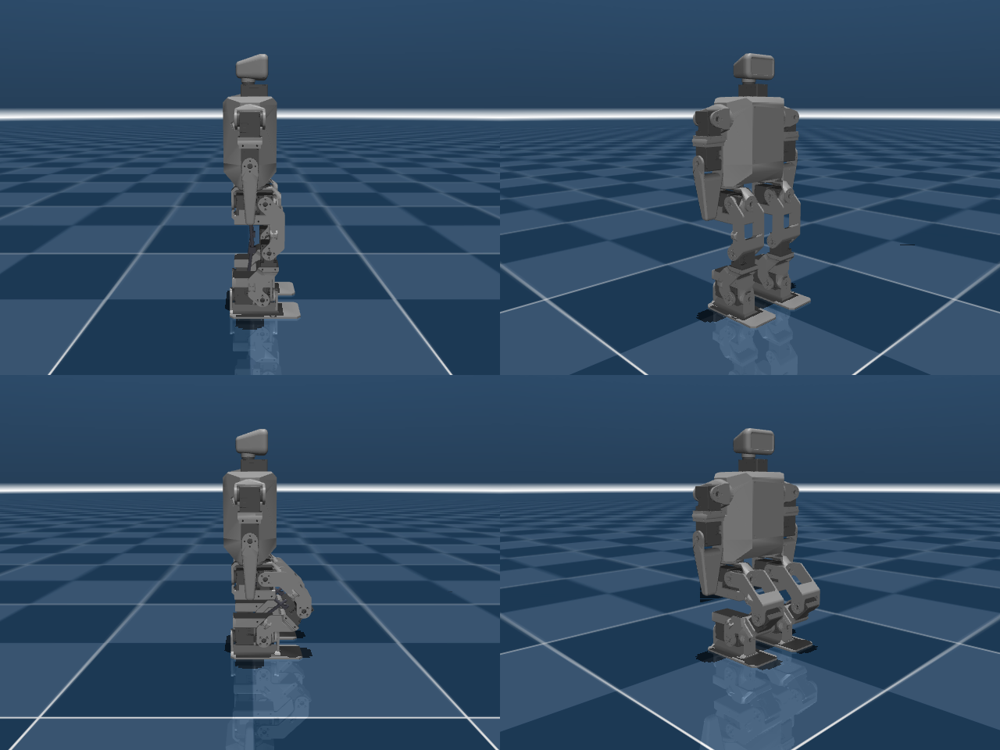

# reduced-dof-humanoid

Reduced-DOF humanoid for ROBO-ONE Light, derived from Rhoban's
[Microban](https://github.com/Rhoban/microban) (unofficial, not affiliated with
Rhoban or the author of Microban).

**Status: experimental.** The current content is a MuJoCo model of Microban in
which the ankle-pitch servos are replaced by passive parallel-link legs and the
head is fixed to the trunk without a servo (19 → 16 actuators), plus the scripts that generate and verify it. The longer
term goal is a 12-servo robot that still satisfies the ROBO-ONE Light rules.

<p align="center">
  
</p>

## Why

Pollen Robotics' Microduck walks with 15 servos and no arms or ankle roll,
driven by a learned policy. It suggests that the usual 19–20 servo layout of
small humanoids is more than a walking robot strictly needs. ROBO-ONE Light,
however, requires two actuated arms, a head, and 10 mm foot clearance when
walking in all four directions, so the question is where the axes can be cut
while staying inside those rules and while keeping keyframe-style control
practical. The study behind this repository is in
[docs/design_ja.md](docs/design_ja.md) (Japanese).

| Joint | Decision | Reason |
| --- | --- | --- |
| Ankle pitch | passive (done here) | Two parallelograms per leg keep the foot parallel to the pelvis, as on the `ashigaru` robot. |
| Neck | remove (done here) | Rules only require a separate head, not an actuated one. A fixed head keeps the humanoid silhouette at zero servo cost. |
| Waist | remove (planned) | Not needed for walking or getting up. |
| Hip yaw | remove (planned) | Turning by asymmetric strides; ROBOTIS Mini already does without it. |
| Shoulder roll | remove (planned) | Rules require one actuated axis per arm; shoulder pitch + elbow is enough for punching and getting up. |
| Hip roll, hip pitch, knee, ankle roll | keep | Needed for lateral stepping, 10 mm foot lift and flat-footed weight transfer with position-controlled servos. |

Target layout: legs 4 × 2, arms 2 × 2, fixed head → 12 servos.

## What is in the repository

```
model/microban_pl/
  microban_pl.xml        parallel-link Microban with fixed head, upstream joint names, position actuators
  microban_pl_lme.xml    same model with LegacyMotionEditor joint names (r_hipjoint_yp, ...)
  scene.xml              floor + "standing" keyframe for the MuJoCo viewer
  assets/                Microban meshes (unmodified, CC BY-NC-SA 4.0)
tools/
  make_microban_pl.py    generates the models above from Microban's robot.xml
  verify_parallel_leg.py loop closure, foot-parallel sweep and standing tests
  render_preview.py      renders docs/images/preview.png
docs/
  design_ja.md           DOF reduction study (ROBO-ONE Light rules, Microduck, per-joint decisions)
```

### Fixed head

The head body and mesh are kept, but the neck yaw joint and its servo are
removed, so the head bolts directly to the trunk. Pass `--neck-motor` to the
generator to keep the servo.

### The parallel-link leg

Per leg, a passive knee block is inserted between the femur and the tibia and
two passive rear links close two parallelogram loops (`<connect>` constraints).
The knee block, and therefore the foot, stay parallel to the pelvis in pitch.
Consequences:

- The ankle-pitch joint is passive; its servo and horn can be removed from the
  physical robot.
- The knee servo now acts between the knee block and the tibia, so the knee
  command is the shank angle **relative to the pelvis**, not to the thigh.
  Existing Microban motions must be re-authored.
- Hip-pitch is limited to −96°…+68° and knee to −68°…+96° (pelvis-relative) to
  stay clear of the linkage singularities. The rear pivots sit 20 mm behind the
  front pivots with a 5 mm tilt that pushes the singularities away from the
  crouching direction.
- The rear links are drawn as thin capsules and do not collide; interference
  with the real parts is not modelled yet.

### Verification

`tools/verify_parallel_leg.py` checks the model in MuJoCo:

| Test | Result |
| --- | --- |
| Loop closure residual at the initial pose | 0.000 mm |
| Foot tilt relative to the trunk over 8 hip/knee combinations (gravity off) | ≤ 0.4° |
| Standing on a floor for 3 s, straight legs | trunk tilt 0.08° |
| Standing with hip −30° / knee +30° | trunk tilt 0.12°, feet flat |
| Standing with hip −60° / knee +60° | trunk tilt 0.33°, feet flat |

With the original Microban model, commanding the same two hip/knee values
without adjusting the ankle tips the robot over; here the linkage keeps the
soles flat automatically.

## Usage

Requirements: Python 3.10+, `mujoco` (≥ 3.1), `numpy`; `Pillow` for rendering.

```bash
# view
python -m mujoco.viewer --mjcf model/microban_pl/scene.xml
# regenerate from a Microban checkout
python tools/make_microban_pl.py path/to/microban/src/model/mjcf/robot.xml \
    model/microban_pl/microban_pl.xml --scene model/microban_pl/scene.xml
python tools/make_microban_pl.py path/to/microban/src/model/mjcf/robot.xml \
    model/microban_pl/microban_pl_lme.xml --naming lme
# verify
python tools/verify_parallel_leg.py model/microban_pl/microban_pl.xml
# preview image
MUJOCO_GL=egl python tools/render_preview.py model/microban_pl/scene.xml docs/images/preview.png
```

`make_microban_pl.py --back <m> --tilt <m>` changes the rear-pivot geometry;
`--keep-motor` keeps Microban's torque actuators for RL use.

For [LegacyMotionEditor](https://github.com/hijimasa/LegacyMotionEditor) point
`model_path` at `microban_pl_lme.xml`; the editor detects the four closed loops
and hides the eight passive joints from the sliders.

## Roadmap

1. Mechanical design of the rear links and knee block so the ankle-pitch
   servo can actually be removed from a printed Microban.
2. Remove hip yaw and shoulder roll (16 → 12 servos) and re-check
   walking, side-stepping and getting up in simulation.
3. Foot-sole and leg-length check against the ROBO-ONE Light tables
   (sole ≤ 55 % of leg length, width ≤ 35 %).

## License

- Code, documentation and the generated MJCF files: **Apache-2.0** (the upstream
  `robot.xml` is itself Apache-2.0; its notice is retained).
- Meshes in `model/microban_pl/assets/`: **CC BY-NC-SA 4.0**, copyright Marc
  Duclusaud, unmodified copies from Microban. This makes the model as a whole
  **non-commercial**; see [NOTICE.md](NOTICE.md).

If you use Microban-derived content, please also cite Microban:

```bibtex
@software{mduclusaud-microban,
    author = {Duclusaud, Marc},
    doi = {10.5281/zenodo.20784789},
    month = jun,
    title = {{Microban: A Compact, Fully 3D-Printable Open-Source Humanoid Robot}},
    url = {https://github.com/Rhoban/microban},
    version = {1.0.0},
    year = {2026}
}
```

---

## 日本語の概要

Rhoban の Microban を元に、ROBO-ONE Light に出られる範囲で軸数をできるだけ減らした
ヒューマノイドを検討する実験用リポジトリです（非公式。Rhoban および原作者とは無関係）。

現在の内容は、ashigaru 方式のパラレルリンク脚で足首ピッチを受動化した Microban の
MuJoCo モデルと、その生成・検証スクリプトです。頭はモータ無しで胴体に固定します（19 軸 → 16 軸）。膝サーボの指令角は
大腿基準ではなく骨盤基準になります。股ピッチは −96°〜+68°、膝は −68°〜+96° に制限しています。

今後は股ヨー・肩ロールを外して 12 軸にすることと、足首サーボを実際に外せるように
3D モデル（後方リンクと膝ブロック）を設計することを予定しています。
軸ごとの削減判断と ROBO-ONE Light 規則との対応は [docs/design_ja.md](docs/design_ja.md) にまとめています。

メッシュは Microban の CAD 由来で CC BY-NC-SA 4.0 のため、モデル全体として非営利利用に限られます。
