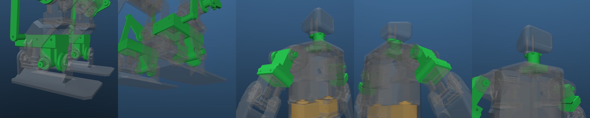
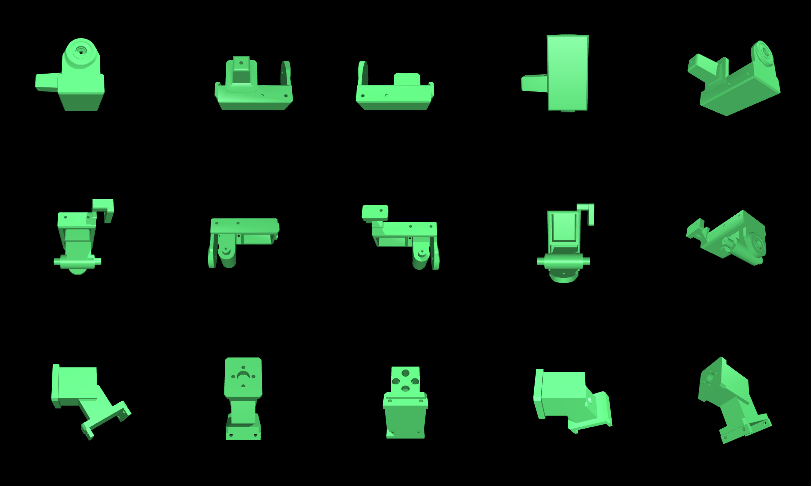

# reduced-dof-humanoid（日本語）

ROBO-ONE Light 向けに軸数を減らしたヒューマノイドの検討リポジトリです。Rhoban の
[Microban](https://github.com/Rhoban/microban) から派生していますが、Rhoban および原作者
Marc Duclusaud 氏とは無関係の非公式プロジェクトです。英語版は [README.md](README.md)。

**状態: 実験段階。** 同じ生成スクリプトから 3 つの MuJoCo モデルを出しています。

| モデル | 構成 | 質量 |
| --- | --- | --- |
| 16 軸（中間段階） | 足首ピッチをパラレルリンクで受動化、頭を固定 | 0.800 kg |
| **12 軸（標準）** | さらに肩ロールと股ヨーを省略。脚 4×2、腕 2×2。股ヨーの位置には XL330 と同じ外形の 3D プリント製ダミーを入れ、足首・肩・首は隣の部品と一体化した印刷部品にする | 0.718 kg |
| **14 軸（アップグレード）** | 12 軸の股ヨー位置のダミーを本物のサーボに差し替えたもの。その場旋回ができる | 0.748 kg |

Microban は 19 軸、0.819 kg です。外したサーボはすべて同形のダミーに置き換えるので、
元のブラケットは無改造で使え、サーボは後から戻せます。

<p align="center">
  
</p>

## なぜ軸を減らすのか

Pollen Robotics の Microduck は腕も足首ロールも無い 15 軸で、学習したポリシーで歩きます。
小型ヒューマノイドの標準的な 19〜20 軸は、歩くだけなら過剰だと示唆しています。
一方 ROBO-ONE Light の規則は、各 1 軸以上の可動軸を持つ 2 本の腕、胴体と独立した頭、
足裏を 10 mm 以上上げた前後左右の歩行を要求します。そこで「規則の中で、キーフレーム制御のまま
どこまで削れるか」を検討しました。詳細は [docs/design_ja.md](docs/design_ja.md)。

| 軸 | 判断 | 理由 |
| --- | --- | --- |
| 足首ピッチ | 受動化（実施済み） | 大腿・下腿の平行四辺形で足裏を骨盤と平行に保つ（ashigaru と同じ機構） |
| 首 | 省略（実施済み） | 規則は頭の存在と寸法のみ要求。固定頭でも外形は保てる |
| 肩ロール | 省略（実施済み） | 規則は腕 1 軸以上。肩ピッチ＋肘でパンチと起き上がりはできる |
| 股ヨー | 12 軸では省略、14 軸で復活 | 無いと両足が常に平行で、旋回は床との滑りに頼る（Robovie-nano と同じ） |
| 股ロール・股ピッチ・膝・足首ロール | 残す | 横移動、10 mm の足上げ、位置制御サーボでの足裏を水平に保った荷重移動に必要 |

## リポジトリの内容

```
model/microban_pl12/     12 軸モデル（標準）。本家の関節名版、LME 命名版、ビューア用シーン
model/microban_pl14/     14 軸モデル（アップグレード）
model/microban_pl/       16 軸モデルと、Microban のメッシュ（無改変、CC BY-NC-SA 4.0）
model/parts/             追加部品の印刷用ドラフト STL（tools/make_parts.py の出力）
model/parts_derived/     Microban の CAD から派生した部品（CC BY-NC-SA 4.0）: 80 mm 足裏、一体化した足首ブロック、首付きの頭
tools/
  make_microban_pl.py    Microban の robot.xml から上記モデルを生成する
  make_parts.py          リンク、膝ヨーク、軸キャップ、スペーサ、ダミーサーボの CadQuery スクリプト
  verify_parallel_leg.py 閉ループ残差・足裏平行性・起立の検証
  check_clearance.py     股・膝の可動域を走査して追加部品の干渉を報告
  render_preview.py      プレビュー画像の生成
  render_parts_check.py  追加部品の配置図（元部品を半透明に）の生成
  step_holes.py          Microban の STEP から穴パターンを読む
docs/
  design_ja.md           軸数削減の検討メモ（規則との対応、各段階の検証結果、費用）
  parts_ja.md            追加部品の設計メモ（ピボット配置、配置制約、部品一覧、未確認事項）
```

## パラレルリンク脚

脚ごとに、大腿と脛に沿った 2 つの平行四辺形をリンクバーで作り、膝ブロックと足裏を骨盤と
平行に保ちます。足首ピッチの関節は受動になり、サーボとホーンを外せます。

- 膝サーボの指令角は大腿基準ではなく**骨盤基準**になります。既存の Microban のモーションは作り直しが必要です。
- 大腿側のバーは大腿の**後ろ**にあり、ピボットは股・膝の軸の後方 22 mm・下 8 mm（特異点は屈曲 110.6°、伸展 69.4°）。
  股側のピボットは股ブラケットの後ろ裾のすぐ横、大腿側板が決して掃かない象限に来るので、ブラケットから生やした
  ラグで持ちます（`parts_derived/hip_block_integrated`。壁にフランジを当て、20×22 から 10×10 へ 23 mm でテーパーし、付け根はフィレット。直角の根元にしない）。
  下腿側のバーは脛の後ろで、後方 30 mm・上 30 mm（足首ロールサーボと足を避けるため。特異点 135° / 45°）。
  特異点から 8° の余裕をとり、可動域は股ピッチ −100°〜+62°、膝 −37°〜+127°（骨盤基準）です。
- モデル上のリンクと膝ヨークは `tools/make_parts.py` の STL を緑色で描き、衝突形状（凸包）も持たせています。
  `tools/check_clearance.py` で可動域を走査しても他部品との干渉はありません。

## 実機で変わる部品

| 部品 | 変更 | モデル上の効果 |
| --- | --- | --- |
| 足首ブロック | 足首ピッチの XL330 とアイドラホーンを外す。2 つのサーボをまたぐ Microban の足首ブロック（キャップ）を、サーボの位置にヒンジ体を持つ 1 部品として印刷し直す。ピッチ軸上の Ø5.9 スタブ軸が脛側板の既存穴に入り、下腿バーのピボットボスも外側に一体化（`parts_derived/ankle_block_integrated_{right,left}`） | 片足 47 g → 32 g。膝は 132° まで折れる（元は 117°） |
| 首 | 胴体上部の XL330 を外す（Microban は首サーボを逆さに付けていて、ホーンが胴体側、頭がサーボ本体側）。頭に首を生やした 1 部品として印刷し直す（`parts_derived/head_integrated`）。頭の裏の旧ホーン座（PCD 12 の穴と座ぐり）はパッドで埋め、旧サーボ軸上の素直な Ø18 ステムがポケットに入る台座まで下りる。固定はホーン用の M2 4 本で胴体の内側から。頭の位置は変わらない | −17 g |
| 肩ロール | 上腕上端の XL330 を外す。肩ブラケットと上腕を 1 つの太い印刷部品にする（`parts/shoulder_arm_simple_{right,left}`）。残すのは Microban とのインターフェースだけ: 肩ピッチホーンの PCD 12 の板と、Microban の上腕プレートと同じ肘サーボの保持（XL330 の端面にねじ穴は無く、ホーン側の面とアイドラ側の面の上隅の穴にホーン軸方向の M2 4 本。天板から下がる 2 枚の短いタブ、x −45.4 / −20.0）。腕は元のロール軸まわりに 30° 回した形で、24×18 の胴（壁 3 mm、角は丸め）が板と 16×16 の柱をつなぐ。ホーンの 4 本のねじは胴を貫く Ø5 の段付き穴からドライバで締める。垂らした腕は膝のリンク積層の真上にあるので、外転させて初めて歩行で肘を前に曲げられる（歩容は前 60°）。`--arm-abduct` で角度を変えられる | −30 g |
| 股ヨー（12 軸） | 胴体下部の XL330 2 個を外し、ダミーを入れる。14 軸ではサーボに戻す | −30 g |
| リンクバー | 脚ごとに前方の大腿バー 1 本（62.2 mm）と後方の下腿バー 1 本（61.7 mm）、3×8 mm、M2 ピン。どちらも脚の外側で面を分けて配置 | 平行四辺形を閉じる |
| 膝ヨーク | 膝の外側の三角板。両バーのピボットを持ち、膝軸キャップに乗る。大腿バーの上側ピボットは股ブラケット前面の小さな耳で持つ | 6 g |
| 膝軸キャップ | 膝サーボのホーンに共締めし、Ø8 のスタブ軸を外側に出す | ヨークの軸受け |

配置は何度か見直しました。いずれも `tools/check_clearance.py` の可動域走査、歩容の再生、ブラケット延長部の
CAD 交差チェック（`tools/make_parts.py` が報告）で確認しています。垂らした前腕を避けるため一時は大腿バーを
前に置きましたが、腕を外転させてその理由が消え、前のバーは支持の迂回が長くなるので、後ろに戻して股ブラケットの
すぐ横で支持する形にしました。両バーが後ろにあるので大腿バーはヨークの外側（35〜38 mm）に置きます（内側だと
ヨークの下腿ピンが掃き、股伸展 57° 以上で膝軸スタブにも当たる）。経緯・横方向の積層・配置制約・未確認事項は
[docs/parts_ja.md](docs/parts_ja.md) にまとめています。印刷前に Onshape で元部品と組み合わせて確認してください。

質量は 0.833 kg（本家モデル）→ 0.800 kg（16 軸）→ 0.748 kg（14 軸）→ 0.718 kg（12 軸）。印刷部品は 1.0 g/cm³（PLA、壁 3 層・充填 40 % 程度）で計上し、一体化足首ブロック 15.9 cm³、肩＋上腕 9.3 cm³、頭に生やした首 6.4 cm³、股ヨーのダミー 7.7 cm³（2 mm シェル）。`--dummies` で以前の、足首・肩・首にもサーボ形状のダミーを使う版が生成できます。

<p align="center">
  
</p>

<p align="center">
  
</p>

<p align="center">
  
</p>

## 検証

`tools/verify_parallel_leg.py` による機構の検証と、LegacyMotionEditor のモーションツールによる
動作検証（サーボ零点誤差 0.3° と初期傾き 1° の外乱付き 8 試行）:

| 項目 | 12 軸 | 14 軸 |
| --- | --- | --- |
| 閉ループ残差（初期姿勢） | 0.000 mm | 0.000 mm |
| 前進・後退・横移動 | 8/8 | 8/8 |
| 旋回 | 8/8（すり足） | 8/8（股ヨー、72° / 141°） |
| ジャブ | 8/8 | 8/8 |
| うつ伏せからの起き上がり | 0/8（未解決） | 0/8（未解決） |
| 仰向けからの起き上がり（寝返り＋同じ起き上がり） | 0/8（未解決） | 0/8（未解決） |

起き上がりは再び未解決です。大腿バーが 5 mm 前に出たためうつ伏せの接地姿勢が変わり、前の形状で見つけた 6 姿勢の経路
（当時 7/8・8/8）が通らなくなりました。最終形状での再探索を進めています。歩行は肘を前に 60° 曲げ、腕は肩の一体部品で 30° 外転した姿勢で行います。起き上がりは、
追加部品に衝突形状を付け腕を外転させたあとに探索し直したものです。うつ伏せでは前方の大腿バーと
膝ヨークが先に床に着き、腕の形が変わると押す位置も変わるため以前の経路が通らなくなり、新しい
6 姿勢の経路は寝返って反対向きに立ち上がります。14 軸は同じ姿勢列を独自のタイミングで使っています。
探索は 16 シード中 15 が膝立ちの局所解で止まったので、探索し直すときは複数シードが必要です。

歩行は静的歩行で約 36 mm/s です。Microban 本家の RL 歩行（前進上限 0.7 m/s）のような動的歩行とは
方式が違います。肘は本家と同じ ±125° で、起き上がりは肘を後ろ側に曲げて押す経路を使っています
（前屈曲のみに制限すると起き上がりの頑健性が大きく落ちました。`--elbow-flexion-only` で制限できます）。

## 使い方

必要なもの: Python 3.10 以上、`mujoco`（3.1 以上）、`numpy`。描画には `Pillow`、部品生成には `cadquery`。

```bash
# ビューアで見る
python -m mujoco.viewer --mjcf model/microban_pl12/scene.xml      # 12 軸
python -m mujoco.viewer --mjcf model/microban_pl14/scene.xml      # 14 軸
# Microban のクローンから再生成
python tools/make_microban_pl.py path/to/microban/src/model/mjcf/robot.xml \
    model/microban_pl12/microban_pl12.xml --dof 12 --meshdir ../microban_pl/assets --parts ../../parts \
    --scene model/microban_pl12/scene.xml
# 検証
python tools/verify_parallel_leg.py model/microban_pl12/microban_pl12.xml
python tools/check_clearance.py model/microban_pl12/microban_pl12.xml     # 追加部品の干渉走査
# 部品 STL と配置図
python tools/make_parts.py model/parts path/to/microban/cad/step   # 第 2 引数で Microban の STEP から派生部品も生成
MUJOCO_GL=egl python tools/render_parts_check.py model/microban_pl12/scene.xml docs/images/parts_check.png
```

主なオプション: `--dof 16|14|12`、`--naming lme`（LegacyMotionEditor の関節名）、`--back`/`--tilt`/
`--shank-back`/`--shank-tilt`（ピボット配置。負で前方・上。可動域はそこから計算）、`--link-x`/`--shank-link-x`
（バーの横方向の面）、`--clevis`、`--keep-ankle-servo`、
`--neck-motor`、`--keep-motor`（RL 用のトルクアクチュエータ）、`--elbow-flexion-only`、`--forearm-ext`。

LegacyMotionEditor では `*_lme.xml` を使います。閉ループを検出して受動関節をスライダーから隠し、
受動関節の名前は Meridim の対応表に無いものにしてあるので、サーボのスロットと衝突しません。

## 費用概算

Microban の BOM（XL330 1 個 $23.90、サーボ以外 約 $113）に、追加部品の M2 ねじ・ワッシャ・
フィラメント約 $5 を足したものです。設定用の U2D2 一式（$56）は共通で別。

| 構成 | サーボ | 合計 | Microban（$567）比 |
| --- | --- | --- | --- |
| 12 軸標準 | 12 | 約 $405 | −$162（−29 %） |
| 14 軸 | 14 | 約 $453 | −$114（−20 %） |

## ROBO-ONE Light の規定との照合

モデル上の実測（脚長は規定どおり「最上部のピッチ軸から足裏まで、脚を伸ばした状態」）:

| 規定（1 kg 以下） | この脚長（146 mm）での上限 | Microban のまま | このリポジトリ |
| --- | --- | --- | --- |
| 足裏の前後長 ≤ 脚長の 55 % | 80.4 mm | 90 mm | 接地板を 80 mm に（`--sole-length` 既定値）。実機の足も短縮が必要 |
| 足裏の左右幅 ≤ 脚長の 35 % | 51.2 mm | 45 mm | 45 mm |
| 立位で左右の足裏が重ならない | — | 27 mm 離れている | 同左 |
| しゃがみ歩行禁止（膝関節 90° 以下はしゃがみ） | > 90° | — | 立ち姿勢を高くして歩容を再調整（docs/design_ja.md） |

## 今後

1. ドラフト部品を Onshape で元部品と組み合わせてフィット確認し、印刷する。
2. 足裏寸法を ROBO-ONE Light の表（脚長の 55 % / 35 %）と照合する。
3. 動的歩行を試すなら、本家の学習パイプライン mjlab_microban にこのモデルを差し替える。

## ライセンス

- コード、ドキュメント、生成した MJCF: **Apache-2.0**（本家 robot.xml も Apache-2.0 で、その表示を保持）。
- `model/microban_pl/assets/` のメッシュ: **CC BY-NC-SA 4.0**（Marc Duclusaud 氏、Microban から無改変で複製）。
  このためモデル全体としては**非営利**に限られます。キットとして販売するには原作者の許諾が必要です。
  詳細は [NOTICE.md](NOTICE.md)。

Microban 由来の内容を使う場合は Microban も引用してください（[README.md](README.md) の BibTeX 参照）。
